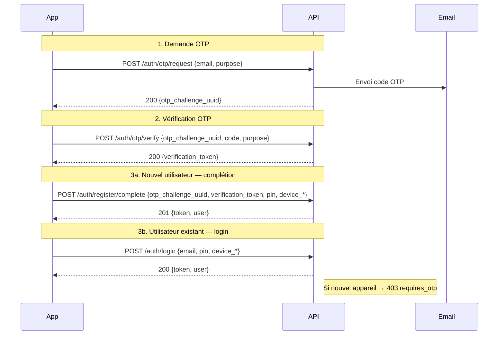

# Authentication

KORA BUS utilise un flow d'authentification basé sur **OTP email + PIN** avec émission d'un **token Sanctum** (Bearer). Ce flow est conçu pour les applications mobiles qui doivent gérer des appareils de confiance.

## Vue d'ensemble du flow



## 1. Demander un OTP

<Endpoint
  method="POST"
  path="/api/v1/auth/otp/request"
/>

### Paramètres

| Champ | Type | Requis | Description |
|-------|------|--------|-------------|
| `email` | string | oui | Email de l'utilisateur |
| `purpose` | enum | oui | `registration`, `login_new_device`, `pin_reset`, `account_unlock` |

### Exemple Dart

<CodeGroup>

```dart
final response = await dio.post('/api/v1/auth/otp/request', data: {
  'email': 'passager@korabus.app',
  'purpose': 'registration',
});

final challengeUuid = response.data['otp_challenge_uuid'];
```

</CodeGroup>

## 2. Vérifier l'OTP

<Endpoint
  method="POST"
  path="/api/v1/auth/otp/verify"
/>

### Paramètres

| Champ | Type | Requis | Description |
|-------|------|--------|-------------|
| `otp_challenge_uuid` | uuid | oui | UUID reçu à l'étape 1 |
| `purpose` | enum | oui | Même `purpose` qu'à l'étape 1 |
| `code` | string (6 digits) | oui | Code OTP reçu par email |

### Exemple Dart

<CodeGroup>

```dart
final response = await dio.post('/api/v1/auth/otp/verify', data: {
  'otp_challenge_uuid': challengeUuid,
  'purpose': 'registration',
  'code': '569775',
});

final verificationToken = response.data['verification_token'];
```

</CodeGroup>

## 3a. Compléter l'inscription (nouvel utilisateur)

<Endpoint
  method="POST"
  path="/api/v1/auth/register/complete"
/>

### Paramètres

| Champ | Type | Requis | Description |
|-------|------|--------|-------------|
| `otp_challenge_uuid` | uuid | oui | UUID de l'étape 1 |
| `verification_token` | string | oui | Token de l'étape 2 |
| `pin` | string (4 digits) | oui | PIN choisi par l'utilisateur |
| `device_name` | string | oui | Nom lisible de l'appareil |
| `platform` | enum | oui | `android`, `ios`, `web`, `unknown` |
| `device_fingerprint` | string | oui | Empreinte unique de l'appareil |
| `push_token` | string | non | Token Firebase / APNs |

### Réponse (201)

```json
{
    "data": {
        "token": "1|aBcDeFgHiJkLmNoPqRsTuVwXyZ...",
        "user": {
            "uuid": "...",
            "name": "...",
            "email": "..."
        }
    }
}
```

## 3b. Connexion (utilisateur existant)

<Endpoint
  method="POST"
  path="/api/v1/auth/login"
/>

### Paramètres

| Champ | Type | Requis | Description |
|-------|------|--------|-------------|
| `email` | string | oui | Email |
| `pin` | string (4 digits) | oui | PIN |
| `device_name` | string | oui | Nom de l'appareil |
| `platform` | enum | oui | `android`, `ios`, `web`, `unknown` |
| `device_fingerprint` | string | oui | Empreinte |
| `push_token` | string | non | Token push |
| `otp_challenge_uuid` | uuid | conditionnel | Requis si nouvel appareil |
| `verification_token` | string | conditionnel | Requis si nouvel appareil |

### Réponse (200)

```json
{
    "data": {
        "token": "2|xYzAbCdEfGhIjKlMnOpQrStUvWxYz...",
        "user": { ... }
    }
}
```

### Réponse nouvel appareil (403)

Si la connexion provient d'un appareil inconnu, l'API retourne un challenge OTP :

```json
{
    "error": {
        "code": "otp_required",
        "message": "Nouvel appareil détecté. Vérification OTP requise.",
        "challenge": {
            "otp_challenge_uuid": "..."
        }
    }
}
```

Le client doit alors enchaîner : `otp/request` → `otp/verify` → `login` avec `otp_challenge_uuid` + `verification_token`.

## Utiliser le token

Tous les endpoints protégés requièrent le header `Authorization: Bearer <token>` :

<CodeGroup>

```dart
final authDio = KoraApiClient.create(authToken: token);

final me = await authDio.get('/api/v1/auth/me');
print(me.data['data']['name']);
```

</CodeGroup>

## Réinitialisation de PIN

Si l'utilisateur oublie son PIN :

1. `POST /auth/otp/request` avec `purpose: "pin_reset"`
2. `POST /auth/otp/verify` avec le code reçu
3. `POST /auth/pin/reset` avec `otp_challenge_uuid`, `verification_token`, nouveau `pin`

## Déverrouillage de compte

Après plusieurs PIN incorrects, le compte est verrouillé (`423 account_locked`). Le client doit :

1. `POST /auth/otp/request` avec `purpose: "account_unlock"`
2. `POST /auth/otp/verify`
3. `POST /auth/unlock` avec `otp_challenge_uuid` + `verification_token`

## Déconnexion

<Endpoint
  method="POST"
  path="/api/v1/auth/logout"
/>

Révoque le token courant. Le client doit purger le token stocké localement.

<Card title="Guide suivant" href="/guides/bus-search" icon="arrow-right" iconType="solid">
  Maintenant que vous êtes authentifié, explorez la **recherche de bus**.
</Card>
