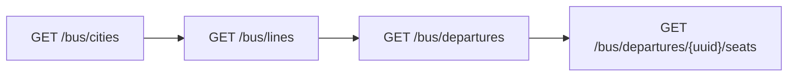

# Recherche Bus

Le parcours de recherche est le point d'entrée du client passager. Il s'enchaîne en 4 étapes : **villes → lignes → départs → sièges**.



## 1. Lister les villes desservies

<Endpoint
  method="GET"
  path="/api/v1/bus/cities"
/>

Retourne les villes actives dérivées des arrêts de bus en service.

<CodeGroup>

```dart
final response = await dio.get('/api/v1/bus/cities');
final cities = response.data['data'] as List;

// cities: [
//   { "uuid": "...", "name": "Cotonou", "country": "BJ" },
//   { "uuid": "...", "name": "Abidjan", "country": "CI" },
//   ...
// ]
```

</CodeGroup>

<Note>
  Cet endpoint est **public** et mis en cache côté serveur. Il peut être appelé au démarrage de l'app pour précharger la liste des villes.
</Note>

## 2. Lister les lignes

<Endpoint
  method="GET"
  path="/api/v1/bus/lines"
/>

Filtrable par segment origine/destination.

### Paramètres

| Param | Type | Requis | Description |
|-------|------|--------|-------------|
| `from` | string | non | Ville d'origine (ex: `Cotonou`) |
| `to` | string | non | Ville de destination (ex: `Abidjan`) |

<CodeGroup>

```dart
final response = await dio.get('/api/v1/bus/lines', queryParameters: {
  'from': 'Cotonou',
  'to': 'Abidjan',
});

final lines = response.data['data'] as List;
// Chaque ligne contient: uuid, code, from_city, to_city, duration_minutes, stops[]
```

</CodeGroup>

## 3. Détail d'une ligne

<Endpoint
  method="GET"
  path="/api/v1/bus/lines/{uuid}"
/>

Retourne la ligne avec ses **arrêts ordonnés**. Les UUIDs d'arrêts sont nécessaires pour la sélection de sièges par segment.

<CodeGroup>

```dart
final lineUuid = lines.first['uuid'];
final response = await dio.get('/api/v1/bus/lines/$lineUuid');

final line = response.data['data'];
final stops = line['stops'] as List;
// stops: [
//   { "uuid": "stop-1", "city": "Cotonou", "order": 1, "arrival_offset": 0 },
//   { "uuid": "stop-2", "city": "Bohicon", "order": 2, "arrival_offset": 90 },
//   { "uuid": "stop-3", "city": "Abidjan", "order": 3, "arrival_offset": 480 },
// ]
```

</CodeGroup>

<Warning>
  Conservez les `uuid` des arrêts d'origine et de destination — ils sont requis pour l'endpoint sièges à l'étape suivante.
</Warning>

## 4. Rechercher des départs

<Endpoint
  method="GET"
  path="/api/v1/bus/departures"
/>

### Paramètres

| Param | Type | Requis | Description |
|-------|------|--------|-------------|
| `date` | string (Y-m-d) | oui | Date de voyage |
| `from` | string | non | Ville d'origine |
| `to` | string | non | Ville de destination |

<CodeGroup>

```dart
final response = await dio.get('/api/v1/bus/departures', queryParameters: {
  'date': '2026-08-20',
  'from': 'Cotonou',
  'to': 'Abidjan',
});

final departures = response.data['data'] as List;
// Chaque départ contient: uuid, departure_time, line, bus, available_seats, fare_preview
```

</CodeGroup>

### Champ `fare_preview`

Le `fare_preview` est un **aperçu** du tarif actif. Il ne crée pas de devis figé. Le devis serveur figé est porté par `/api/v1/pricing` (à venir).

## 5. Détail d'un départ

<Endpoint
  method="GET"
  path="/api/v1/bus/departures/{uuid}"
/>

<CodeGroup>

```dart
final departureUuid = departures.first['uuid'];
final response = await dio.get('/api/v1/bus/departures/$departureUuid');

final departure = response.data['data'];
// departure: { uuid, departure_time, line, bus, segment, available_seats, fare_preview }
```

</CodeGroup>

## 6. Plan des sièges

<Endpoint
  method="GET"
  path="/api/v1/bus/departures/{uuid}/seats"
/>

### Paramètres

| Param | Type | Requis | Description |
|-------|------|--------|-------------|
| `origin_stop_uuid` | uuid | oui | UUID de l'arrêt de montée |
| `destination_stop_uuid` | uuid | oui | UUID de l'arrêt de descente |

<CodeGroup>

```dart
final originStop = stops.first['uuid'];
final destinationStop = stops.last['uuid'];

final response = await dio.get(
  '/api/v1/bus/departures/$departureUuid/seats',
  queryParameters: {
    'origin_stop_uuid': originStop,
    'destination_stop_uuid': destinationStop,
  },
);

final seats = response.data['data'] as List;
// seats: [
//   { "seat_number": "1A", "status": "available", "row": 1, "column": "A" },
//   { "seat_number": "1B", "status": "occupied", "row": 1, "column": "B" },
//   { "seat_number": "2A", "status": "blocked", "row": 2, "column": "A" },
// ]
```

</CodeGroup>

Voir le guide [Sélection de sièges](/guides/seat-selection) pour les statuts et la logique de segment.

<Card title="Guide suivant" href="/guides/seat-selection" icon="arrow-right" iconType="solid">
  Comprendre les **statuts de sièges** et la logique de segment O/D.
</Card>
