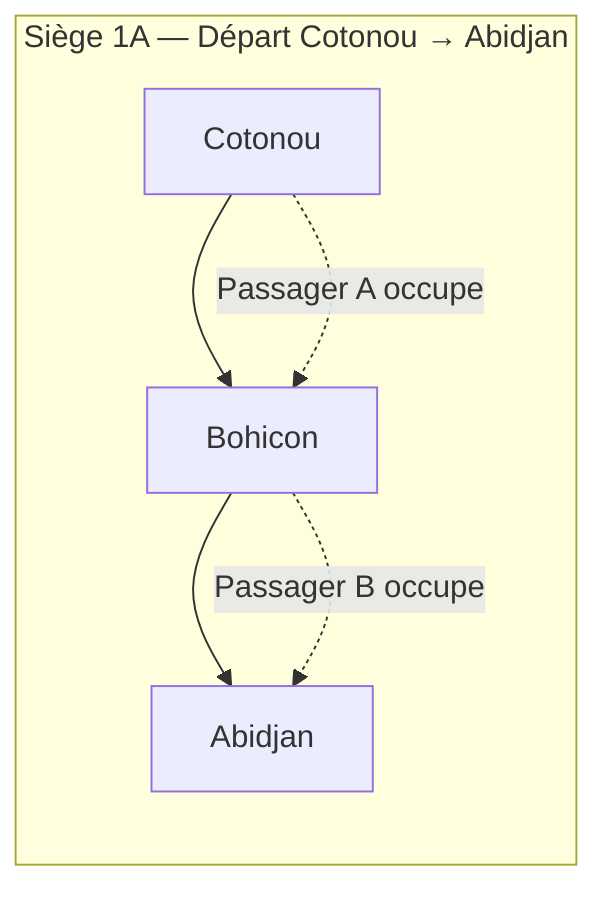

# Sélection de sièges

KORA BUS vend des **segments** : un passager peut monter à un arrêt intermédiaire et descendre à un autre. La disponibilité d'un siège dépend donc du **segment origine/destination (O/D)** demandé, pas du départ complet.

## Statuts de siège

| Statut | Description | Action client |
|--------|-------------|----------------|
| `available` | Libre sur le segment demandé | Sélectionnable |
| `occupied` | Réservé sur le segment demandé | Non sélectionnable |
| `blocked` | Bloqué (maintenance, équipage, segment chevauchant) | Non sélectionnable |

## Logique de segment

Un siège peut être `available` pour le segment Cotonou → Bohicon mais `occupied` pour Cotonou → Abidjan, parce qu'un autre passager l'a réservé pour le segment Bohicon → Abidjan.



Dans cet exemple :
- Segment **Cotonou → Bohicon** : siège `occupied` (Passager A)
- Segment **Bohicon → Abidjan** : siège `occupied` (Passager B)
- Segment **Cotonou → Abidjan** : siège `occupied` (chevauchement A + B)

## Statuts de réservation bloquants

Les statuts de réservation qui rendent un siège `occupied` :

| Statut réservation | Description |
|--------------------|-------------|
| `held` | Siège bloqué temporairement (panier, expiration imminente) |
| `confirmed` | Réservation confirmée |
| `paid` | Payée |
| `ticketed` | Billet émis |
| `boarded` | Passager embarqué |

## Appel API

<Endpoint
  method="GET"
  path="/api/v1/bus/departures/{uuid}/seats"
/>

### Paramètres requis

| Param | Type | Description |
|-------|------|-------------|
| `origin_stop_uuid` | uuid | Arrêt de montée |
| `destination_stop_uuid` | uuid | Arrêt de descente |

### Exemple Dart

<CodeGroup>

```dart
final response = await dio.get(
  '/api/v1/bus/departures/$departureUuid/seats',
  queryParameters: {
    'origin_stop_uuid': originStopUuid,
    'destination_stop_uuid': destinationStopUuid,
  },
);

final seats = response.data['data'] as List;

// Filtrer les sièges disponibles
final available = seats.where((s) => s['status'] == 'available').toList();
```

</CodeGroup>

## Affichage du plan dans Flutter

<CodeGroup>

```dart
// lib/features/booking/widgets/seat_map.dart
import 'package:flutter/material.dart';

class SeatMap extends StatelessWidget {
  final List<Map<String, dynamic>> seats;

  const SeatMap({super.key, required this.seats});

  @override
  Widget build(BuildContext context) {
    // Grouper par rangée
    final rows = <int, List<Map<String, dynamic>>>{};
    for (final seat in seats) {
      final row = seat['row'] as int;
      rows.putIfAbsent(row, () => []).add(seat);
    }

    return Column(
      children: rows.entries.map((entry) {
        final sorted = entry.value
          ..sort((a, b) => (a['column'] as String).compareTo(b['column'] as String));
        return Row(
          mainAxisAlignment: MainAxisAlignment.center,
          children: sorted.map((seat) => _SeatButton(seat: seat)).toList(),
        );
      }).toList(),
    );
  }
}

class _SeatButton extends StatelessWidget {
  final Map<String, dynamic> seat;

  const _SeatButton({required this.seat});

  @override
  Widget build(BuildContext context) {
    final status = seat['status'] as String;
    final color = switch (status) {
      'available' => Colors.green,
      'occupied' => Colors.red.shade300,
      'blocked' => Colors.grey,
      _ => Colors.grey,
    };

    return Padding(
      padding: const EdgeInsets.all(4),
      child: Container(
        width: 40,
        height: 40,
        decoration: BoxDecoration(
          color: color,
          borderRadius: BorderRadius.circular(8),
        ),
        child: Center(
          child: Text(
            seat['seat_number'] as String,
            style: const TextStyle(fontSize: 10, color: Colors.white),
          ),
        ),
      ),
    );
  }
}
```

</CodeGroup>

<Note>
  Le `fare_preview` retourné avec le départ est un **aperçu**. Le prix figé par segment est obtenu via `/api/v1/pricing` (à venir). Ne pas afficher de prix définitif côté client avant figeage serveur.
</Note>

<Card title="Guide suivant" href="/guides/error-handling" icon="arrow-right" iconType="solid">
  Gérez proprement les **erreurs et codes de retour** de l'API.
</Card>
